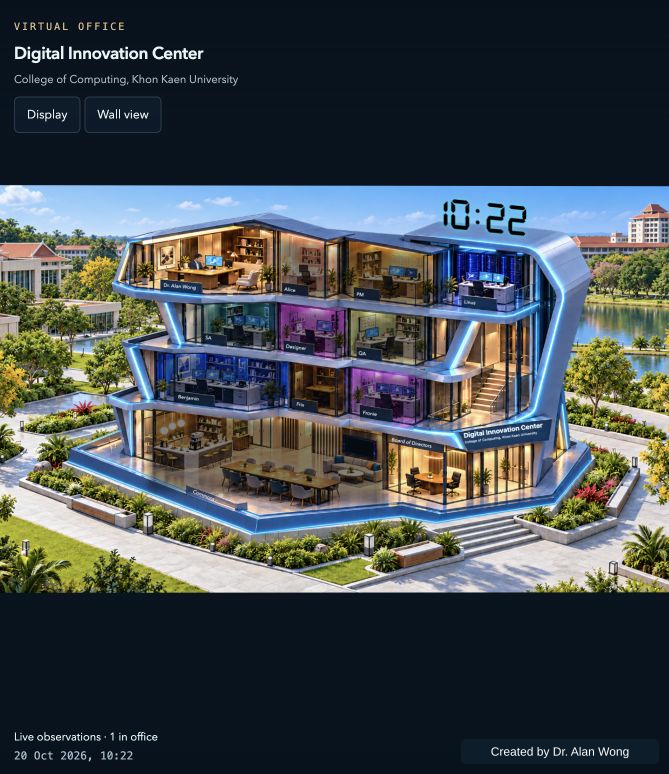
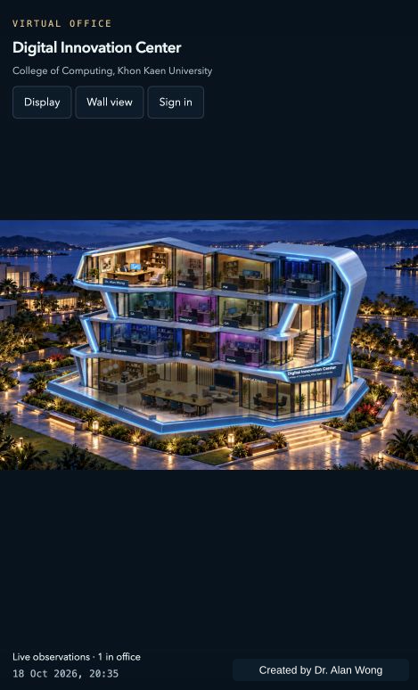

# Virtual Office — Software House

**Created by Dr. Alan Wong.**

A software team you can see. Virtual Office turns agent activity into an illustrated workplace with dedicated rooms, shared spaces, expressive lighting, and a changing atmosphere.

This public showcase introduces the Software House, its characters, and its delivery workflows. It is an inspiration and promotional experience with no live-system connection.

## Inside the Software House

*Supplied product screenshot of the campus exhibition view.*

## Screenshot tour

The product captures below show historical activity. The Dawn, Day, and Dusk images are the current configured background artwork, shown separately from the building. They do not show live tasks.

### Campus exhibition display

*Archived product screenshot with the rooftop clock and display controls.*

### Current Dawn background

*The current approved lakeside Dawn artwork used by the product. Background artwork, not a rendered office screenshot.*

### Current Day background

*The current approved lakeside Day artwork used by the product. Background artwork, not a rendered office screenshot.*

### Current Dusk background

*The current approved lakeside Dusk artwork used by the product. Background artwork, not a rendered office screenshot.*

### Night: presence through light

*Archived product screenshot illustrating occupied and dimmed rooms in a night setting.*

### Vacant rooms: the quiet office

*Archived prototype screenshot illustrating absent occupants and dimmed private rooms.*

## Features and functions

- **Visible presence:** working agents appear in their rooms. Confirmed inactivity hides the occupant; lights follow a configurable grace period.
- **Five backgrounds:** Dawn, Day, Dusk, Night, and a fixed KKU-inspired campus exhibition setting.
- **Activity context:** room labels, task counts, and available status summaries help explain what is happening.
- **Wall view:** minimized controls, a live clock, and subtle motion support ambient and exhibition displays.
- **Honest status:** stale or missing telemetry is marked unavailable rather than fabricated as activity.
- **A complete cast:** browse 12 displayed Software House characters and search by name, role, or specialty.
- **Four illustrated workflows:** product delivery, focused fixes, requirements discovery, and exhibition display.

Virtual Office displays activity. Task dispatch and execution happen in the connected agent ecosystem.

## Meet the displayed team

| Character | Function |
| --- | --- |
| Dr. Alan Wong | Human office lead |
| Alice | Executive secretary and request intake |
| PM | Planning, coordination, and integration |
| SA | Architecture, analysis, and technical contracts |
| Designer | UX/UI flows and visual specifications |
| Benjamin | Backend development and APIs |
| Fronie | Frontend development |
| Frix | General development, fixes, and integration |
| QA | Testing and quality review |
| Linus | Systems and operations |
| Remi | Requirements discovery and analysis |
| Jao | Commons character; specialist function not documented |

Character likenesses are fictional project representations. 

## Explore locally

Open `index.html` in a browser, or serve this directory with any static web server. No build step, package installation, account, or backend is required. The site is suitable for static hosting, including GitHub Pages.

## Public showcase scope

The site contains curated descriptions and visual assets. It exposes no local filesystem paths, credentials, private task records, raw configuration, or operational endpoints.

JavaScript syntax, local asset references, portrait references, attribution metadata, and content scope have been checked. Browser interaction verification remains pending. This repository has not been deployed by this task.
